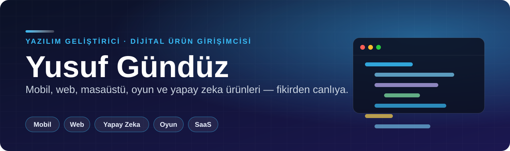

 

## 👋 Hakkımda

Ben **Yusuf Gündüz**, [Revolasoft](https://revolasoft.com) kurucusu ve yazılım geliştiriciyim. Mobil uygulama, web platformu, masaüstü yazılım, oyun ve yapay zeka destekli ürünleri **fikirden canlıya** kadar tek elden geliştiriyorum: ürün tasarımı, kodlama, mağaza ve sunucu yayını, SEO ve bakım dahil.

| 📱 Mobil | 🌐 Web | 🖥️ Masaüstü | 🎮 Oyun | 🤖 Yapay Zeka |
|:---:|:---:|:---:|:---:|:---:|
| **10** uygulama Android ve iOS | **8** canlı platform | CRM ve iş sistemleri | Web, Unity, Roblox | Whisper, Gemini |

## 📱 Mobil Uygulamalar

Google Play ve App Store için geliştirdiğim uygulamalar:

| Uygulama | Ne yapar | Android | iOS |
|---|---|:---:|:---:|
| **Asi Yemek** | Samandağ'a özel yemek sipariş uygulaması (React Native, Expo, Supabase) | ✅ Yayında | ✅ Yayında |
| **Star Invest Real Estate** | Gayrimenkul uygulaması | 🧪 Kapalı test | ✅ Yayında |
| **Enzo Kozmetik** | Kozmetik markası uygulaması | — | ✅ Yayında |
| **Dizipas** | Dizi ve film izleme ve takip uygulaması | ✅ Yayında | ⏳ İncelemede |
| **Astrya** | Kahve falı ve tarot uygulaması | ✅ Yayında | — |
| **AI Quiz** | LGS, YKS ve KPSS için yapay zeka destekli soru çözüm uygulaması | ✅ Yayında | — |
| **Süper Futbol Düellosu** | Mobil futbol oyunu | 🧪 Kapalı test | ⏳ İncelemede |
| **Hava Pusulası** | Hava durumu uygulaması | ✅ Yayında | ✅ Yayında |
| **Gündüz Emlak** | Emlak uygulaması | — | 🛠️ Yayına hazırlanıyor |
| **Sanal Kabin** | Yapay zeka ile kıyafet deneme uygulaması | — | 🛠️ Yayın sürecinde |

## 🌐 Canlı Web Platformları

| Platform | Ne yapar | Adres |
|---|---|---|
| **Revolasoft** | Yazılım geliştirme markam | [revolasoft.com](https://revolasoft.com) |
| **HavaPusula** | Türkiye geneli il ve ilçe hava durumu, saatlik veri, 15 günlük tahmin | [havapusula.com.tr](https://havapusula.com.tr) |
| **MiraTekstil** | Perde ve ev tekstili e-ticaret platformu | [miratekstiltr.com](https://www.miratekstiltr.com) |
| **Star Invest Real Estate** | Gayrimenkul platformu | [starinvestrealestate.com](https://www.starinvestrealestate.com) |
| **Enzo Kozmetik** | Kozmetik markası kurumsal sitesi | [enzokozmetik.com](https://enzokozmetik.com) |
| **Garage Wear** | Vintage giyim e-ticaret mağazası | [garagewear.com.tr](https://garagewear.com.tr) |
| **Sanal Kabin** | Yapay zeka ile sanal deneme kabini | [kabinsanal.com](https://www.kabinsanal.com) |
| **Gündüz Emlak** | Emlak ilan platformu | [gunduzemlaksamandag.com](https://www.gunduzemlaksamandag.com) |

## 🖥️ Masaüstü Yazılımlar ve İş Sistemleri

- **Star Invest CRM:** Emlak danışmanları için Electron + React masaüstü CRM'i ve web tabanlı CRM (backend ve frontend).
- **Gündüz Emlak Pro:** Kurumsal portföy, müşteri ve sunum yönetim sistemi; kurulum paketiyle dağıtılır.
- **İçerik Stüdyosu:** Sosyal medya içerik üretimi için SaaS ürün çalışması.
- **Canlı Mezat Yönetim Sistemi:** Instagram canlı satışları için yönetim paneli.
- **Randevu sistemi:** Kuaför ve hizmet işletmeleri için Next.js tabanlı uygulama.

## 🎮 Oyun Geliştirme

- **Age of Wars 2.5D:** Phaser ve React ile 2.5D savaş stratejisi oyunu.
- **Backrooms:** Three.js ile tarayıcıda çalışan, prosedürel labirentli 3B korku oyunu.
- **World's Hardest Game:** React, TypeScript ve canvas ile sıfırdan yazılmış 10 bölümlü web oyunu. → [Kaynak kod](https://github.com/yusufgunduz-dev/World-s-Hardest-Game)
- **Unity ve Roblox:** C# ile Unity prototipleri, Rojo ile Roblox oyunları.

## 🤖 Otomasyon ve Yapay Zeka Araçları

| Araç | Ne yapar |
|---|---|
| [**Auto Subtitle Generator**](https://github.com/yusufgunduz-dev/auto-subtitle-generator) | Whisper ile Türkçe altyazı üretir, FFmpeg ile videoya gömer. Komut satırı ve grafik arayüz. |
| [**Video Compressor**](https://github.com/yusufgunduz-dev/Video-Compressor-Reduce-Video-File-Size-) | H.264 ile kaliteyi koruyarak video sıkıştırır ve keser. Masaüstü arayüz. |
| **WebScraper Premium** | Veri toplama için Python masaüstü uygulaması. |
| **YouTube ve Etsy araçları** | İçerik ve mağaza süreçleri için otomasyon betikleri. |

## 🔓 Açık Kaynak Projeler

MIT lisanslı, Türkçe ve İngilizce belgeli, CI ile test edilen projelerim:

| Proje | Ne yapar | Teknoloji |
|---|---|---|
| [**diyabet-risk-ai**](https://github.com/yusufgunduz-dev/diyabet-risk-ai) | CDC BRFSS ve NHANES verisiyle diyabet riski tahmini: 8 model, SHAP açıklamaları, FastAPI ve tarayıcıda çalışan sürüm. [Canlı demo](https://diyabet-risk-analizi.netlify.app) | Python, scikit-learn, XGBoost, SHAP |
| [**convert-chrome-extension**](https://github.com/yusufgunduz-dev/convert-chrome-extension) | PDF, Word, Excel, resim ve HEIC dosyalarını OCR ile tarayıcıda, cihazdan çıkarmadan dönüştüren Chrome eklentisi | TypeScript, React, Manifest V3 |
| [**ai-quiz-app**](https://github.com/yusufgunduz-dev/ai-quiz-app) | LGS, YKS ve KPSS için Gemini destekli soru üreten mobil quiz uygulaması | React Native, Expo, Firebase |
| [**google-maps-scraper**](https://github.com/yusufgunduz-dev/google-maps-scraper) | Google Haritalar işletme kayıtlarını Excel'e aktaran masaüstü araç | Python, Selenium |
| [**auto-subtitle-generator**](https://github.com/yusufgunduz-dev/auto-subtitle-generator) | Whisper ile Türkçe altyazı üretip videoya gömer | Python, Whisper, FFmpeg |
| [**Video-Compressor**](https://github.com/yusufgunduz-dev/Video-Compressor-Reduce-Video-File-Size-) | Kaliteyi koruyarak video sıkıştırma ve kesme | Python, FFmpeg |
| [**World's Hardest Game**](https://github.com/yusufgunduz-dev/World-s-Hardest-Game) | Sıfırdan yazılmış canvas oyun motoruyla 10 bölümlü web oyunu | React, TypeScript |

## 🛠️ Teknolojiler

## 🎓 Eğitim ve Sertifikalar

Python ile Makine Öğrenmesi · Python ile Siber Güvenlik Uygulamaları · Veri Bilimi için Python ve TensorFlow · SQL · Joomla

## 🤝 İletişim

Yeni bir ürün, mobil uygulama ya da web platformu mu planlıyorsunuz?

- 🌐 [revolasoft.com](https://revolasoft.com)
- ✉️ [gunduzy718@gmail.com](mailto:gunduzy718@gmail.com)

Kaynak kodlarının büyük kısmı müşteri ve ticari projeler olduğu için özel depolarda tutulmaktadır.

